<h2 align="center">👋 Hi there, I'm Sergio</h2>

  <b>Backend & AI Engineer</b> · I build AI agents and systems that make it to production. 
  Multi-agent assistants, RAG, voice and LLM pipelines on Google Cloud. Badajoz, Spain.

  
  
  
  
  

  

  <picture>
    <source media="(prefers-color-scheme: dark)" srcset="./profile/stats-dark.svg">
    
  </picture>
  <picture>
    <source media="(prefers-color-scheme: dark)" srcset="./profile/top-langs-dark.svg">
    
  </picture>

  <picture>
    <source media="(prefers-color-scheme: dark)" srcset="https://streak-stats.demolab.com?user=sergiomarquezdev&theme=material-palenight&hide_border=true&background=FFFFFF00&sideNums=A6ACCD&sideLabels=C792EA&dates=7C83A8&currStreakNum=A6ACCD&currStreakLabel=C792EA&ring=C792EA&fire=FFCB6B&stroke=444267">
    
  </picture>

<h2 align="center">✨ Some projects</h2>

- 📰 [One dAIly Blog](https://blog.sergiomarquez.dev) Autonomous blog: an AI pipeline researches, writes, illustrates and publishes a technical article every day.
- 🤖 [Personal AI Agent](https://github.com/sergiomarquezdev/adk-agent-personal) Multi-agent system with Google ADK (orchestrator + specialists) that answers about my CV and searches my blog.
- 🔎 [Multimodal Vector Search](https://github.com/sergiomarquezdev/gemini-embeddings-2-mongo-demo) Semantic search over text, images, PDFs, audio and video with `gemini-embedding-2` and MongoDB Atlas.
- 🎙️ [YT Transcriber](https://github.com/sergiomarquezdev/yt-transcriber) CUDA-accelerated Whisper transcription with multi-provider AI summaries and social content generation.
- 📺 [Acestream Docker Home](https://github.com/sergiomarquezdev/acestream-docker-home) One-click Acestream on Windows, Linux and macOS via Docker, with a bilingual web player.
- 🔌 [One Bad Wire](https://sergiomarquezdev.itch.io/one-bad-wire) Godot puzzle game: fix the wiring of a telephone exchange before everything fails.
- 🐧 [Pingufly](https://sergiomarquezdev.itch.io/pingufly) Launch a penguin as far as you can. Rebuilt in 3D with Godot and AI-generated models.
- 🐧 [PinguFly 2D](https://github.com/sergiomarquezdev/pingufly-2d) The original 2D version, in plain JavaScript.
- 🎬 [Short AI videos](https://www.youtube.com/@sergio_marquezp) Daily vertical videos explaining AI concepts, made by my own pipeline: script, voice, animation and captions.
- ✋ [Pizarra Digital](https://github.com/sergiomarquezdev/pizarra-digital-python) Digital whiteboard controlled with hand gestures through the webcam.
- 🐍 [Python Fundamentals](https://github.com/sergiomarquezdev/python-fundamentals) A practical Python guide in Spanish, from the basics to advanced topics.
- 🌐 [sergiomarquez.dev](https://github.com/sergiomarquezdev/sergiomarquez-dev) My portfolio: bilingual, data-driven, built with Astro.

🔒 Private and running in production: a self-hosted WhatsApp AI agent, a 24/7 AI voice receptionist and a brief-to-video ad generator. <a href="https://sergiomarquez.dev/en/#projects-title">More on my portfolio</a>.

<h2 align="center">🌱 My Skills</h2>

<h4 align="center">💻 Languages</h4>

<h4 align="center">🧠 AI and LLMs</h4>

<h4 align="center">📚 Frameworks and Libraries</h4>

<h4 align="center">🗄️ Data</h4>

<h4 align="center">☁ Cloud and DevOps</h4>

